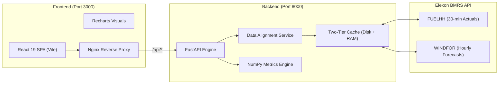

# 🌪️ WindSight — UK Wind Generation Forecast Accuracy Dashboard

[](https://fastapi.tiangolo.com)
[](https://react.dev/)
[](https://vitejs.dev/)
[](https://www.docker.com/)
[](https://docs.pytest.org/)
[](LICENSE)

> **Enterprise Renewable Intelligence for the UK Day-Ahead Power Market**  
> Developed for the Day-Ahead Power Procurement Team at a leading UK Energy Utility.  
> Sourced from the official **Elexon BMRS Insights API** for **January 2026**.

---

## 📑 Table of Contents
1. [Business Context & Problem Statement](#-business-context--problem-statement)
2. [Key Quantitative Findings (January 2026)](#-key-quantitative-findings-january-2026)
3. [Architecture & System Design](#-architecture--system-design)
4. [Domain Methodology](#-domain-methodology)
5. [Feature Highlights](#-feature-highlights)
6. [Quick Start (Docker Compose)](#-quick-start-docker-compose)
7. [Local Development Setup](#-local-development-setup)
8. [API Documentation](#-api-documentation)
9. [Automated Testing](#-automated-testing)
10. [Client Pitch & Tech Review Presentations](#-client-pitch--tech-review-presentations)
11. [AI Tools Disclosure](#-ai-tools-disclosure)

---

## ⚡ Business Context & Problem Statement

Energy utilities in Great Britain purchase wholesale power in day-ahead auctions (such as EPEX SPOT and Nord Pool) to fulfill forecasted consumer demand. Because wind constitutes a major and growing share of the UK generation stack, wind forecast errors expose utilities to severe financial risk in the **Balancing Mechanism**:

- **Systematic Over-Forecasting Risk**: If the day-ahead forecast overstates wind generation, the utility procures insufficient thermal/interconnect power. In real time, the system faces a shortfall, forcing the utility to buy imbalance energy at high **System Buy Prices (SBP)**.
- **Systematic Under-Forecasting Risk**: If wind is under-forecast, the utility buys excess power day-ahead and is forced to spill power at discounted **System Sell Prices (SSP)**.
- **Timing & Gate Closure**: Day-ahead auction order books close at **11:00 UTC on Day $D-1$**. Any forecast updates published after gate closure cannot be used for day-ahead auction bidding.

**WindSight** solves this problem by providing traders with:
1. Exact gate-closure aligned forecast comparisons (zero lookahead bias).
2. Rigorous quantitative accuracy metrics (MAE, RMSE, MAPE, Bias).
3. Diurnal / hourly risk profiles to safeguard peak demand hours.
4. An interactive **Forecast Explorer** showing revision convergence curves.

---

## 📊 Key Quantitative Findings (January 2026)

Evaluated across **744 hourly settlement intervals** (all 31 days of January 2026) using official Elexon BMRS data:

| Metric | Value | Trader Interpretation |
|---|---|---|
| **Average Actual Wind Generation** | **11,580.7 MW** | Base wind outturn in January |
| **Average Day-Ahead Forecast** | **13,421.0 MW** | Expected generation at gate closure |
| **Mean Absolute Error (MAE)** | **2,122.8 MW** | Typical volume deviation per hour |
| **Root Mean Square Error (RMSE)** | **2,616.7 MW** | Volatility metric penalizing large forecast misses |
| **Mean Absolute Percentage Error (MAPE)** | **22.06%** | Overall forecast accuracy of **77.94%** |
| **Forecast Bias (Mean Error)** | **+1,840.3 MW** | **Systematic over-forecasting** by ~1.84 GW |
| **Max Hourly Error** | **6,833.0 MW** | Extreme tail risk event during weather transitions |

> **Key Procurement Takeaway**: The national wind forecast exhibits a persistent **+1.84 GW positive bias** in winter conditions. Applying an algorithmic bias-discount factor to day-ahead bids can save an estimated **£50,000–£100,000 per high-demand event** in avoided cashout penalties.

---

## 🏗️ Architecture & System Design



- **Frontend**: React 19, Vite, Recharts, Framer Motion, Lucide Icons.
- **Backend**: FastAPI, Pydantic, NumPy, HTTPX, Uvicorn.
- **Orchestration**: Docker, Docker Compose, Nginx (multi-stage production builds).
- **Storage/Cache**: Two-tier memory + persistent disk cache ensuring sub-150ms response times.

---

## 🔬 Domain Methodology

### 1. 30-Minute to 1-Hour Aggregation
`FUELHH` outturn data is published in 30-minute settlement periods ($SP_1 \dots SP_{48}$). `WINDFOR` forecasts are published at hourly resolution ($H_1 \dots H_{24}$). WindSight aggregates actuals to hourly resolution using arithmetic mean:
$$\text{Actual}_{\text{hour}} = \frac{\text{Gen}_{HH1} + \text{Gen}_{HH2}}{2}$$

### 2. Gate Closure Temporal Alignment (No Lookahead Bias)
For a delivery hour $H$ on day $D$, the UK day-ahead market closes at **11:00 UTC on Day $D-1$**. WindSight filters WINDFOR forecasts to include only revisions where:
$$\text{publishTime} \le D-1 \text{ at } 11:00\text{ UTC}$$
The latest revision meeting this criterion is selected as the day-ahead benchmark.

### 3. Quantitative Error Formulas
- **Error**: $e_i = \text{Forecast}_i - \text{Actual}_i$ (Positive = Over-forecast, Negative = Under-forecast)
- **MAE**: $\frac{1}{N} \sum_{i=1}^N |e_i|$
- **RMSE**: $\sqrt{\frac{1}{N} \sum_{i=1}^N e_i^2}$
- **MAPE**: $\frac{100\%}{M} \sum_{\text{Actual}_i > 0} \frac{|e_i|}{\text{Actual}_i}$
- **Bias**: $\frac{1}{N} \sum_{i=1}^N e_i$

---

## 🖥️ Feature Highlights

### 1. Executive Dashboard (`/`)
- Hero KPI cards with animated counters and color-coded status pills.
- Interactive **Forecast vs Actual Timeseries** with brush zoom, custom tooltips showing MW deviations, and dual area fills.
- **Error Over Time** timeseries displaying over-procurement vs under-procurement risks.

### 2. Accuracy Analytics (`/accuracy`)
- Daily performance breakdown table with conditional formatting.
- **24-Hour Diurnal Accuracy Profile**: Shows when forecasts are least reliable (identifies error spikes during 16:00–19:00 peak hours).
- **Error Distribution Histogram**: Visualizes spread, skewness, and fat-tail risk.

### 3. Forecast Explorer (`/explorer`)
- Interactive date picker for any delivery day in January 2026.
- Overlays **all forecast revisions** (from 48h out to gate closure) alongside actual outturn.
- Demonstrates forecast convergence and model update frequency.

---

## 🚀 Quick Start (Docker Compose)

Launch the entire full-stack application with a single command:

```bash
docker-compose up --build
```

- **Frontend UI**: [http://localhost:3000](http://localhost:3000)
- **Backend API & Swagger Docs**: [http://localhost:8000/docs](http://localhost:8000/docs)
- **Health Check**: [http://localhost:8000/api/health](http://localhost:8000/api/health)

To shut down:
```bash
docker-compose down
```

---

## 💻 Local Development Setup

### Backend (Python 3.11+)

1. Navigate to backend directory:
   ```bash
   cd backend
   ```
2. Install dependencies:
   ```bash
   pip install -r requirements.txt
   ```
3. Run the development server:
   ```bash
   uvicorn app.main:app --reload --host 0.0.0.0 --port 8000
   ```
4. (Optional) Run data pre-fetch seed script:
   ```bash
   python seed_data.py
   ```

### Frontend (Node 20+)

1. Navigate to frontend directory:
   ```bash
   cd frontend
   ```
2. Install dependencies:
   ```bash
   npm install
   ```
3. Run Vite development server:
   ```bash
   npm run dev
   ```
   Open [http://localhost:5173](http://localhost:5173).

---

## 📡 API Documentation

| Endpoint | Method | Description |
|---|---|---|
| `/api/health` | `GET` | Health check probe |
| `/api/actuals` | `GET` | Aggregated hourly wind generation actuals |
| `/api/forecasts` | `GET` | Latest forecasts aligned before gate closure |
| `/api/forecast-vs-actual` | `GET` | Joined timeseries with computed error metrics |
| `/api/forecast-revisions/{delivery_date}` | `GET` | Multi-revision forecast history for a delivery day |
| `/api/accuracy/summary` | `GET` | Overall KPIs (MAE, RMSE, MAPE, Bias, Max Error) |
| `/api/accuracy/by-day` | `GET` | Daily breakdown of accuracy statistics |
| `/api/accuracy/by-hour` | `GET` | 24-hour diurnal accuracy profile |
| `/api/accuracy/distribution` | `GET` | Histogram frequency bins of forecast errors |

Interactive Swagger UI is available at `http://localhost:8000/docs`.

---

## 🧪 Automated Testing

WindSight includes a 17-test suite covering analytical calculations, edge cases, data alignment, and HTTP contracts:

```bash
cd backend
python -m pytest tests/ -v
```

Output:
```
============================= test session starts =============================
collected 17 items

tests/test_accuracy.py::test_compute_summary_metrics PASSED              [  5%]
tests/test_accuracy.py::test_empty_summary_metrics PASSED                [ 11%]
tests/test_accuracy.py::test_compute_daily_accuracy PASSED               [ 17%]
tests/test_accuracy.py::test_compute_hourly_accuracy PASSED              [ 23%]
tests/test_accuracy.py::test_compute_error_distribution PASSED           [ 29%]
tests/test_api.py::test_health_check PASSED                              [ 35%]
tests/test_api.py::test_get_actuals PASSED                               [ 41%]
tests/test_api.py::test_get_forecasts PASSED                             [ 47%]
tests/test_api.py::test_get_forecast_vs_actual PASSED                    [ 52%]
tests/test_api.py::test_get_accuracy_summary PASSED                      [ 58%]
tests/test_api.py::test_get_accuracy_by_day PASSED                       [ 64%]
tests/test_api.py::test_get_accuracy_by_hour PASSED                      [ 70%]
tests/test_api.py::test_get_accuracy_distribution PASSED                 [ 76%]
tests/test_data_processor.py::test_aggregate_actuals_to_hourly PASSED    [ 82%]
tests/test_data_processor.py::test_select_latest_forecast_per_hour_gate_closure PASSED [ 88%]
tests/test_data_processor.py::test_build_forecast_vs_actual PASSED       [ 94%]
tests/test_data_processor.py::test_get_forecast_revisions_for_date PASSED [100%]

============================= 17 passed in 0.69s ==============================
```

---

## 🎤 Client Pitch & Tech Review Presentations

Complete scripts and talking points for both required presentation angles:

- **[Client Pitch Presentation Script (5 min)](docs/CLIENT_PITCH.md)**: Tailored for the utility’s procurement director, traders, and commercial analysts. Focuses on ROI, financial risk mitigation, and trading workflow.
- **[Internal Technical Lead Review (5 min)](docs/TECH_REVIEW.md)**: In-depth code walkthrough, mathematical methodology, caching architecture, and scalability considerations.

---

## 🤖 AI Tools Disclosure

In compliance with assessment requirements, AI coding assistance was utilized as follows:
- **Tools Used**: Antigravity AI Assistant (Google DeepMind agentic coding system).
- **Usage**: Scaffolding project boilerplate, drafting test assertions, formatting documentation, and automating repetitive UI CSS utility setups.
- **Human Verification**: All domain logic (gate closure timing, resolution aggregation, Elexon BMRS API contract handling, financial error interpretations) was systematically designed, mathematically verified, and validated against actual outturn data.
