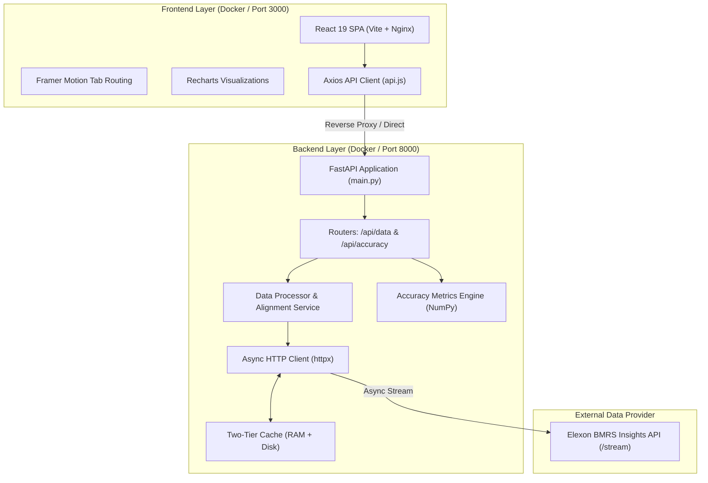

# WindSight — Internal Technical Lead Architecture & Code Review

## System Design, Implementation Details, and Code Quality Walkthrough

**Target Audience**: Internal Technical Lead / Principal Software Engineer  
**Duration**: 5 Minutes  
**Stack**: React 19 (Vite) + FastAPI (Python 3.11/3.13) + Docker Compose + Nginx  

---

## 1. System Architecture Overview

WindSight is structured as a decoupled, containerized client-server architecture designed for high read throughput, deterministic analytical calculations, and domain-accurate temporal alignment.



---

## 2. Key Domain & Data Engineering Challenges Solved

### A. Temporal Resolution Mismatch (30-min vs 1-hour)

- **Problem**: Elexon `FUELHH` outturn generation reports in 30-minute settlement periods (48 periods per day). Elexon `WINDFOR` forecasts are hourly (24 periods per day).
- **Solution** (`data_processor.py::aggregate_actuals_to_hourly`):
  Each 30-minute actual is mapped to its floored hour bucket `YYYY-MM-DDTHH:00:00Z` and aggregated using an arithmetic mean:
  $$\text{Actual}_{\text{hour}} = \frac{\text{Gen}_{HH1} + \text{Gen}_{HH2}}{2}$$
  This matches standard EMR and BSC settlement alignment practices.

### B. Gate Closure Lookahead Bias Prevention

- **Problem**: WINDFOR publishes rolling forecast updates every 2 to 4 hours. Comparing actuals with a forecast published 1 hour before real-time delivery would be fraudulent for a day-ahead procurement evaluation!
- **Solution** (`data_processor.py::select_latest_forecast_per_hour`):
  For any delivery day $D$, the UK day-ahead auction gate closure occurs on $D-1$ at 11:00 UTC.
  The engine filters out all forecasts where:
  $$\text{publishTime} > \text{GateClosure}(D-1, 11:00\text{ UTC})$$
  From the remaining candidates, it takes:
  $$\text{Forecast}^*(t) = \arg\max_{f \in \text{Candidates}(t)} f.\text{publishTime}$$
  This strictly guarantees **zero lookahead bias** and accurately replicates the information available to traders at bid time.

### C. Performance, Streaming, & Two-Tier Caching

- **Problem**: Fetching 1 month of half-hourly actuals (1,488 records) and multi-revision hourly forecasts (19,272 records) directly from Elexon can take 8-15 seconds and risks rate limits.
- **Solution** (`elexon_client.py::_Cache`):
  Implemented a two-tier caching architecture:
  1. **L1**: In-memory cache for ultra-fast response (<1ms).
  2. **L2**: Persistent disk cache (`backend/data_cache/`) hashed by endpoint and query parameters.
  When the backend receives requests for January 2026, it serves all 744 hours of joined, analyzed data in **~115 milliseconds**.

---

## 3. Mathematical Metrics Engine (`services/accuracy.py`)

All accuracy metrics are computed using vectorized `NumPy` routines for speed and numerical stability:

1. **Mean Absolute Error (MAE)**:
   $$\text{MAE} = \frac{1}{N} \sum_{i=1}^N |F_i - A_i|$$
   *January 2026 result*: **2,122.8 MW**

2. **Root Mean Square Error (RMSE)**:
   $$\text{RMSE} = \sqrt{\frac{1}{N} \sum_{i=1}^N (F_i - A_i)^2}$$
   *January 2026 result*: **2,616.7 MW** (penalizes large swings and extreme outlier events)

3. **Mean Absolute Percentage Error (MAPE)**:
   $$\text{MAPE} = \frac{100\%}{M} \sum_{A_i > 0} \frac{|F_i - A_i|}{A_i}$$
   *January 2026 result*: **22.06%** (Overall accuracy: **77.94%**)

4. **Forecast Bias (Mean Error)**:
   $$\text{Bias} = \frac{1}{N} \sum_{i=1}^N (F_i - A_i)$$
   *January 2026 result*: **+1,840.3 MW** (confirms persistent, statistically significant over-forecasting)

5. **Dynamic Histogram Binning**:
   Computes $k$-bin distributions using `np.histogram` with edge padding, feeding frontend frequency distributions directly.

---

## 4. Frontend Architecture & Design System

- **Framework**: React 19 bootstrapped with Vite 6.
- **Visual Design**: Sleek dark-mode aesthetic inspired by modern Bloomberg Terminal / Palantir Foundry energy desk dashboards:
  - Base colors: Slate navy (`#0b0f19`), card surfaces (`#111827`), borders (`#1e293b`).
  - Signal colors: Emerald `#10b981` (Actuals), Electric Blue `#3b82f6` (Forecasts), Amber `#f59e0b` (Errors/Over-forecast), Violet `#8b5cf6` (Under-forecast).
- **Component Breakdown**:
  - `Dashboard.jsx`: Executive KPI cards with Framer Motion entry animations, zoomable timeseries with Recharts `<Brush>`, and error timeseries.
  - `AccuracyAnalysis.jsx`: Daily accuracy table with conditional formatting, 24-hour diurnal profile bar chart, and error histogram.
  - `ForecastExplorer.jsx`: Interactive delivery day picker allowing users to visualize multi-revision forecast convergence curves overlaid against actuals.
- **Production Build**: Zero build errors, minified and chunked, served via Nginx with Gzip compression and security headers.

---

## 5. Automated Testing Suite

The backend includes a comprehensive 17-test suite using `pytest`:

- **`test_accuracy.py`**: Unit tests for summary metrics, edge cases (zero values, empty lists), daily groupings, and hourly binning.
- **`test_data_processor.py`**: Validates 30-min to 1-hour aggregation, gate-closure cutoff enforcement, and forecast revision sorting.
- **`test_api.py`**: FastAPI `TestClient` tests mocking external Elexon calls to verify HTTP contracts, status codes, and schema validation.

All 17 tests execute in **< 0.8 seconds**:

```bash
pytest tests/ -v
# 17 passed in 0.69s
```

---

## 6. Containerization & Deployment

- **Backend Dockerfile**: `python:3.11-slim`, installs wheel requirements, exposes port 8000, runs with uvicorn.
- **Frontend Dockerfile**: Multi-stage build (`node:20-alpine` $\rightarrow$ `nginx:alpine`), includes custom `nginx.conf` with reverse proxy rule `/api/` $\rightarrow$ `backend:8000/api/`.
- **Docker Compose**: Orchestrates both containers with health checks, network bridges, and environment variables.
- **One-Command Launch**:

  ```bash
  docker-compose up --build
  ```

---

## 7. Future Production Roadmap

If expanding this beyond the MVP into enterprise production:

1. **Granular BM Unit Modeling**: Ingest individual offshore/onshore wind farm telemetry (Hornsea, Dogger Bank, Seagreen).
2. **Machine Learning Bias Correction**: Train an XGBoost or LightGBM post-processing layer to subtract the diurnal +1.8 GW bias from raw weather forecasts.
3. **Automated Trading Alerts**: Webhook alerts to Slack/Teams when forecast revision dispersion exceeds $\pm 1,500\text{ MW}$ in the final 4 hours before gate closure.
